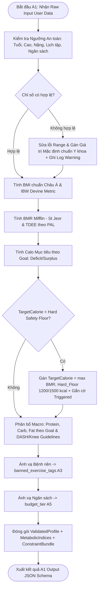

# TÀI LIỆU THIẾT KẾ THUẬT TOÁN (A1)

## HỆ THỐNG CÁ NHÂN HÓA DINH DƯỠNG & LUYỆN TẬP THỂ CHẤT

> **Mục tiêu đồ án:** Xây dựng Web App demo local cho giảng viên đánh giá, ứng dụng **Tư duy tính toán (Computational Thinking)** để giải quyết bài toán chăm sóc sức khỏe theo từng cá nhân.

---

## 📑 MỤC LỤC CHI TIẾT

1. [Phân hệ A1: Thuật toán Kiểm tra Dữ liệu Đầu vào & Dựng Bộ Ràng buộc (Data Validation & Constraint Engine)](#1-phân-hệ-a1-thuật-toán-kiểm-tra-dữ-liệu-đầu-vào--dựng-bộ-ràng-buộc)
   * 1.1. Cơ sở Lý thuyết & Mô hình Ràng buộc (Rule-based Validation & Constraint-Driven Model)
   * 1.2. Bảng Ánh xạ Quy tắc Kiểm tra & Ràng buộc Y khoa - Dinh dưỡng (Validation & Constraint Rules)
   * 1.3. Đặc tả Cấu trúc Dữ liệu (Input & Output JSON Schema)
   * 1.4. Thiết kế Thuật toán & Sơ đồ Luồng (Mermaid Flowchart)
   * 1.5. Mã giả Thuật toán Chi tiết (Pseudocode)
   * 1.6. Luận chứng Tính Đúng đắn & An toàn Y học (Data Normalization & Edge Cases Handling)
2. [Mã nguồn Python Triển khai Production (FastAPI / Backend DataClasses)](#2-mã-nguồn-python-triển-khai-production)
3. [Tài liệu Tham khảo Chính thống](#3-tài-liệu-tham-khảo-chính-thống)
---

## 1. PHÂN HỆ A1: THUẬT TOÁN KIỂM TRA DỮ LIỆU ĐẦU VÀO & DỰNG BỘ RÀNG BUỘC

### 1.1. Cơ sở Lý thuyết & Mô hình Ràng buộc (Rule-based Validation & Constraint-Driven Model)

Thuật toán **A1** đóng vai trò là "Cổng kiểm soát chất lượng dữ liệu" và "Bộ dựng mô hình ràng buộc" cho toàn bộ hệ thống. Nếu dữ liệu đầu vào bị sai lệch hoặc thiếu nhất quán, các thuật toán xử lý phía sau (A2, A3, A4, A5) sẽ dẫn đến kết quả tính toán sai lệch nghiêm trọng.

* **Phát biểu Bài toán Vận hành Phân hệ A1:**
  * **Đầu vào:** Tập hợp các thuộc tính thô từ luồng Onboarding của người dùng bao gồm sinh trắc học, thời gian rảnh, tiền sử bệnh nền, chế độ ăn và ngân sách kinh tế.
  * **Cơ chế Xử lý:**
    1. *Kiểm định Ngưỡng An toàn:* Đánh giá tính khả thi sinh học của các chỉ số (tuổi, chiều cao, cân nặng) và ràng buộc thực tế (số ngày rảnh, thời lượng tập, ngân sách).
    2. *Xử lý Giá trị Khuyết & Trường hợp Biên:* Gán giá trị mặc định chuẩn y khoa hoặc căn chỉnh ngưỡng an toàn tự động.
  * **Đầu ra (Validated Outputs):** Bộ dữ liệu người dùng đã được chuẩn hóa (`ValidatedUserProfile`)

---

### 1.2. Bảng Ánh xạ Quy tắc Kiểm tra & Ràng buộc Y khoa - Dinh dưỡng

| Trường Thông tin (`Field`) | Kiểu Dữ liệu | Miền Hợp lệ (`Valid Range`) | Quy tắc Kiểm tra & Giá trị Mặc định (`Sanity / Fallback Rule`) | Ràng buộc Hệ thống Được Dựng (`Generated Constraint`) |
| :--- | :---: | :---: | :--- | :--- |
| `age` | `int` | $14 \le \text{age} \le 60$ (nam) $14 \le \text{age} \le 55$ (nữ)| Nếu $<14$ hoặc $>55/60$: Gán $\text{age} = 25$ và gắn cờ cảnh báo người dùng. | Xác định hệ số BMR và mức độ nhạy cảm tim mạch. |
| `gender` | `str` | `'male'`, `'female'` | Bắt buộc chọn. Mặc định `'male'` nếu trống. | Chọn công thức BMR (Mifflin - St Jeor) & Sàn Calo ($1200 / 1500\text{ kcal}$). |
| `height_cm` | `float` | $125.0 \le h \le 200.0$ (nam) $120.0 \le w \le 190.0$ (nữ)| Nếu out-of-range: Gán $h = 160.0\text{ cm}$. | Tính BMI, IBW (Devine) và BMR. |
| `weight_kg` | `float` | $40.0 \le w \le 150.0$ (nam) $35.0 \le w \le 140.0$ (nữ) | Nếu out-of-range: Gán $w = 55.0\text{ kg}$. | Tính BMR, TDEE và tổng khối lượng Macro ($g/kg$). |
| `fitness_goal` | `str` | `'fat_loss'`, `'muscle_gain'`, `'maintain'` | Mặc định `'maintain'` nếu không hợp lệ. | Quyết định tỷ lệ Calo thâm hụt/thặng dư ($\pm 15-20\%$) và tỷ lệ Macro. |
| `available_days` | `list[str]` | Số ngày $k \in [1, 7]$ | Nếu $<1$: Gán 1 ngày. Nếu $>7$: Gán 7 ngày. | Định hình Template Lịch tập (Fullbody / Upper-Lower / PPL) cho A4. |
| `session_duration_mins` | `int` | $15 \le t \le 120$ | Nếu $<15p$: Gán $15p$. Nếu $>120p$: Gán $120p$. | Đặt trần ngân sách thời gian ($D_{\text{session}}$) cho buổi tập trong A4. |
| `medical_conditions` | `list[str]` | `['knee_osteoarthritis'`, `'hypertension']` | Mảng rỗng `[]` nếu không có bệnh nền. | Sinh mảng `banned_tags` cho A3 (VD: cấm nén cột sống, cấm gập gối $>90^\circ$). |
| `dietary_preference` | `str` | `'normal'`, `'vegetarian'` | Mặc định `'normal'`. | Bộ lọc loại trừ nguồn thực phẩm mặn/chay cho A5. |
| `daily_budget_vnd` | `float` | $\ge 15,000\text{ VNĐ}$ | Nếu $<15k$: Gán $15,000\text{ VNĐ}$. | Sinh `budget_tier` (`<50k`, `50k-100k`, `>100k`) cho A5. |

---

### 1.3. Đặc tả Cấu trúc Dữ liệu

#### **Input JSON (`A1_Input_Schema`):**
```json
{
  "title": "A1_UserProfile_Input",
  "type": "object",
  "properties": {
    "user_id": { "type": "string" },
    "age": { "type": "integer", "minimum": 10, "maximum": 100 },
    "gender": { "type": "string", "enum": ["male", "female"] },
    "height_cm": { "type": "number", "minimum": 120.0, "maximum": 200.0 },
    "weight_kg": { "type": "number", "minimum": 40.0, "maximum": 150.0 },
    "fitness_goal": { "type": "string", "enum": ["fat_loss", "muscle_gain", "maintain"] },
    "fitness_level": { "type": "integer", "minimum": 1, "maximum": 5 },
    "available_days": {
      "type": "array",
      "items": { "type": "string", "enum": ["Mon", "Tue", "Wed", "Thu", "Fri", "Sat", "Sun"] },
      "minItems": 1,
      "maxItems": 7
    },
    "session_duration_mins": { "type": "integer", "minimum": 15, "maximum": 120 },
    "medical_conditions": {
      "type": "array",
      "items": { "type": "string", "enum": ["knee_osteoarthritis", "hypertension"] }
    },
    "dietary_preference": { "type": "string", "enum": ["normal", "vegetarian"] },
    "daily_budget_vnd": { "type": "number", "minimum": 15000.0 }
  },
  "required": ["user_id", "age", "gender", "height_cm", "weight_kg", "fitness_goal", "available_days", "daily_budget_vnd"]
}
```

#### **Output JSON Schema (`A1_Output_Schema`):**
```json
{
  "title": "A1_ConstraintBundle_Output",
  "type": "object",
  "properties": {
    "user_id": { "type": "string" },
    "is_valid": { "type": "boolean" },
    "validation_warnings": { "type": "array", "items": { "type": "string" } },
    "validated_profile": {
      "type": "object",
      "properties": {
        "age": { "type": "integer" },
        "gender": { "type": "string" },
        "height_cm": { "type": "number" },
        "weight_kg": { "type": "number" },
        "bmi": { "type": "number" },
        "ibw_kg": { "type": "number" },
        "fitness_goal": { "type": "string" },
        "fitness_level": { "type": "integer" },
        "available_days_count": { "type": "integer" },
        "session_duration_mins": { "type": "integer" }
      },
      "required": ["age", "gender", "height_cm", "weight_kg", "bmi", "ibw_kg"]
    },
    "metabolic_indices": {
      "type": "object",
      "properties": {
        "bmr_kcal": { "type": "number" },
        "tdee_kcal": { "type": "number" },
        "target_calorie_kcal": { "type": "number" },
        "is_safety_floor_triggered": { "type": "boolean" },
        "protein_g": { "type": "integer" },
        "carb_g": { "type": "integer" },
        "fat_g": { "type": "integer" }
      },
      "required": ["bmr_kcal", "tdee_kcal", "target_calorie_kcal", "protein_g", "carb_g", "fat_g"]
    },
    "constraint_bundle": {
      "type": "object",
      "properties": {
        "banned_exercise_tags": { "type": "array", "items": { "type": "string" } },
        "budget_tier": { "type": "string", "enum": ["tier_1_under_50k", "tier_2_50k_to_100k", "tier_3_over_100k"] },
        "diet_type": { "type": "string" },
        "medical_guardrails_active": { "type": "boolean" }
      },
      "required": ["banned_exercise_tags", "budget_tier", "diet_type"]
    }
  },
  "required": ["user_id", "is_valid", "validated_profile", "metabolic_indices", "constraint_bundle"]
}
```

---

### 1.4. Thiết kế Thuật toán & Sơ đồ Luồng 



---

### 1.5. Mã giả Thuật toán Chi tiết (Pseudocode)
Có những thuật toán ở bên A2, A3 nên code nào có liên quan đến các thuật toán đó đểu được ghi chú lại.
```plaintext
ALGORITHM Validate_Input_And_Construct_Constraints
INPUT:
    raw_input: RawUserProfileInput

OUTPUT:
    validated_output: ValidatedA1Output

BEGIN
    warnings ← EMPTY_LIST()
    
    // =========================================================================
    // GIAI ĐOẠN 1: KIỂM TRA NGƯỠNG AN TOÀN & SỬA LỖI GIÁ TRỊ (SANITY CHECK)
    // =========================================================================
    age ← raw_input.age
    IF age < 15 OR age > 80 THEN
        age ← 20
        warnings.APPEND("Tuổi ngoài ngưỡng 15-80, tự động điều chỉnh về 20.")
    ENDIF

    gender ← LOWERCASE(raw_input.gender)
    IF gender NOT IN ["male", "female"] THEN
        gender ← "male"
        warnings.APPEND("Giới tính không xác định, tự động gán mặc định nam.")
    ENDIF
    if gender = male THEN
        num_gender = 0
    else
        num_gender = 1
    
    height ← raw_input.height_cm
    IF height < height_min[num_gender] OR height > height_max[num_gender] THEN
        height ← 165.0
        warnings.APPEND("Chiều cao không hợp lệ, gán mặc định 165cm.")
    ENDIF

    weight ← raw_input.weight_kg
    IF weight < weight_min[num_gender] OR weight > weight_max[num_gender] THEN
        weight ← 60.0
        warnings.APPEND("Cân nặng không hợp lệ, gán mặc định 60kg.")
    ENDIF

    budget ← raw_input.daily_budget_vnd
    IF budget < 15000.0 THEN
        budget ← 15000.0
        warnings.APPEND("Ngân sách < 15,000 VNĐ, gán mức tối thiểu 15,000 VNĐ.")
    ENDIF

    days_count ← LENGTH(raw_input.available_days)
    IF days_count < 1 THEN
        days_count ← 1
        warnings.APPEND("Số ngày rảnh < 1, gán tối thiểu 1 buổi/tuần.")
    ELSE IF days_count > 7 THEN
        days_count ← 7
        warnings.APPEND("Số ngày rảnh > 7, gán tối đa 7 buổi/tuần.")
    ENDIF
// 
// =========================================================================
    // GIAI ĐOẠN 2: TÍNH CHỈ SỐ SINH TRẮC & CHUYỂN HÓA (METABOLIC CALCULATIONS)
    // =========================================================================
    height_m ← height / 100.0
    bmi ← weight / (height_m * height_m)

    // Công thức Devine quy đổi hệ mét (bên A2)
    IF gender == "male" THEN
        ibw ← 50.0 + 0.9 * (height - 152.4)
        bmr ← 10.0 * weight + 6.25 * height - 5.0 * age + 5.0
        hard_floor ← 1500.0
    ELSE
        ibw ← 45.5 + 0.9 * (height - 152.4)
        bmr ← 10.0 * weight + 6.25 * height - 5.0 * age - 161.0
        hard_floor ← 1200.0
    ENDIF

    // Ánh xạ PAL dựa trên số buổi tập rảnh (bên A2)
    IF days_count <= 2 THEN
        pal ← 1.375
    ELSE IF days_count <= 4 THEN
        pal ← 1.55
    ELSE
        pal ← 1.725
    ENDIF
    tdee ← bmr * pal

    // Điều chỉnh theo Mục tiêu Thể hình (bên A2)
    goal ← raw_input.fitness_goal
    IF goal == "fat_loss" THEN
        calc_target ← tdee * 0.80  // Thâm hụt 20%
    ELSE IF goal == "muscle_gain" THEN
        calc_target ← tdee * 1.15  // Thặng dư 15%
    ELSE
        calc_target ← tdee * 1.00  // Duy trì
    ENDIF

    // Kiểm soát Sàn An toàn Y tế (Hard Safety Floor) (bên A2)
    is_floor_triggered ← FALSE
    IF calc_target < bmr OR calc_target < hard_floor THEN
        target_calorie ← MAX(bmr, hard_floor)
        is_floor_triggered ← TRUE
        warnings.APPEND("Calo mục tiêu chạm sàn an toàn y tế, đã tự động nâng lên ngưỡng tối thiểu.")
    ELSE
        target_calorie ← calc_target
    ENDIF

    // Phân bổ Tỷ lệ Macro (Protein, Carb, Fat) (bên A2)
    IF goal == "fat_loss" THEN
        p_pct ← 0.40; c_pct ← 0.35; f_pct ← 0.25
    ELSE IF goal == "muscle_gain" THEN
        p_pct ← 0.25; c_pct ← 0.55; f_pct ← 0.20
    ELSE
        p_pct ← 0.30; c_pct ← 0.45; f_pct ← 0.25
    ENDIF

    protein_g ← ROUND((target_calorie * p_pct) / 4.0)
    carb_g ← ROUND((target_calorie * c_pct) / 4.0)
    fat_g ← ROUND((target_calorie * f_pct) / 9.0)
=========================================================================
    // GIAI ĐOẠN 3: DỰNG BỘ RÀNG BUỘC (CONSTRAINT BUNDLE ASSEMBLY) (bên A3)
    // =========================================================================
    banned_tags ← EMPTY_LIST()
    FOR EACH condition IN raw_input.medical_conditions DO
        IF condition == "knee_osteoarthritis" THEN
            banned_tags.APPEND("knee_flexion_over_90")
            banned_tags.APPEND("spine_compression")
            banned_tags.APPEND("open_kinetic_chain_leg_ext")
        ELSE IF condition == "hypertension" THEN
            banned_tags.APPEND("valsalva_press")
            banned_tags.APPEND("decline_head_below_heart")
            banned_tags.APPEND("heavy_1rm_npt")
        ENDIF
    ENDFOR

    IF budget < 50000.0 THEN
        budget_tier ← "tier_1_under_50k"
    ELSE IF budget <= 100000.0 THEN
        budget_tier ← "tier_2_50k_to_100k"
    ELSE
        budget_tier ← "tier_3_over_100k"
    ENDIF

    // =========================================================================
    // ĐÓNG GÓI KẾT QUẢ ĐẦU RA
    // =========================================================================
    validated_output.is_valid ← TRUE
    validated_output.validation_warnings ← warnings
    validated_output.validated_profile ← BUILD_PROFILE(age, gender, height, weight, bmi, ibw, goal, days_count)
    validated_output.metabolic_indices ← BUILD_METABOLIC(bmr, tdee, target_calorie, is_floor_triggered, protein_g, carb_g, fat_g)
    validated_output.constraint_bundle ← BUILD_CONSTRAINTS(banned_tags, budget_tier, raw_input.dietary_preference)

    RETURN validated_output
END


```

### 1.6. Luận chứng Tính Đúng đắn & An toàn Y học

* **Chuẩn hóa Dữ liệu đa miền:**
  Các biến số đầu vào có miền giá trị chênh lệch rất lớn (ngân sách $15,000 - 150,000\text{ VNĐ}$, năng lượng $1200 - 3000\text{ kcal}$, thời gian $15 - 120\text{ phút}$). Trong các phân hệ phía sau (A3, A5), thuật toán sử dụng **Công thức Chuẩn hóa Min-Max** để đưa tất cả thuộc tính số về miền $[0, 1]$ trước khi tính điểm ưu tiên (Scoring Engine):
  $$x_{\text{norm}} = \frac{x - x_{\min}}{x_{\max} - x_{\min}}$$
* **Xử lý Trường hợp Biên:**
  1. *Xung đột giữa Mục tiêu Tăng cơ và Ngân sách thấp ($<50k/\text{ngày}$):* Phân hệ A1 thiết lập cờ `tier_1_under_50k`. Thuật toán A5 sẽ kích hoạt bộ lọc ưu tiên các nguồn đạm thực vật/động vật giá rẻ bản địa (trứng gà, đậu hũ, ức gà công nghiệp) để đạt mốc `protein_g` mà không vượt trần ngân sách.
  2. *Mắc đồng thời nhiều bệnh nền (VD: Vừa Đau khớp gối vừa Tăng huyết áp):* Mảng `banned_tags` sẽ hợp nhất (Union) tất cả nhãn cấm của các bệnh nền. Bộ lọc A3 sẽ loại bỏ triệt để cả bài tập nén cột sống/gập gối sâu và bài tập nín thở Valsalva, đảm bảo an toàn y tế tuyệt đối.
* **Chứng minh An toàn Y tế bằng Sàn Calo:**
  Việc thâm hụt calo quá mức ($\text{CaloMụcTiêu} < \text{BMR}$) làm suy giảm khối cơ, gây rối loạn nội tiết và suy giảm miễn dịch. Thuật toán A1 đảm bảo:
  $$\text{CaloMụcTiêu} = \max(\text{CaloMụcTiêuTínhToán}, \text{BMR}, \text{HardFloor})$$
  Quy tắc này tuân thủ nghiêm ngặt Hướng dẫn lâm sàng của Viện Tim, Phổi và Máu Quốc gia Hoa Kỳ (NIH/NHLBI).

---

## 2. MÃ NGUỒN PYTHON TRIỂN KHAI PRODUCTION (FASTAPI / BACKEND DATACLASSES)

```python
from dataclasses import dataclass, field
from enum import Enum
from typing import List, Dict, Set, Optional, Tuple
import math

# =================================================================────────────
# 2.1. ENUMS VÀ DATA CLASSES DÙNG TRONG PHÂN HỆ A1
# =================================================================────────────

class Gender(str, Enum):
    MALE = "male"
    FEMALE = "female"

class FitnessGoal(str, Enum):
    FAT_LOSS = "fat_loss"
    MUSCLE_GAIN = "muscle_gain"
    MAINTAIN = "maintain"

class DietType(str, Enum):
    NORMAL = "normal"
    VEGETARIAN = "vegetarian"

class BudgetTier(str, Enum):
    TIER_1_UNDER_50K = "tier_1_under_50k"
    TIER_2_50K_TO_100K = "tier_2_50k_to_100k"
    TIER_3_OVER_100K = "tier_3_over_100k"

@dataclass
class RawUserProfileInput:
    user_id: str
    age: int
    gender: str
    height_cm: float
    weight_kg: float
    fitness_goal: str
    fitness_level: int = 1
    available_days: List[str] = field(default_factory=lambda: ["Mon", "Wed", "Fri"])
    session_duration_mins: int = 15
    medical_conditions: List[str] = field(default_factory=list)
    dietary_preference: str = "normal"
    daily_budget_vnd: float = 15000.0

@dataclass
class ValidatedUserProfile:
    user_id: str
    age: int
    gender: Gender
    height_cm: float
    weight_kg: float
    bmi: float
    ibw_kg: float
    fitness_goal: FitnessGoal
    fitness_level: int
    available_days_count: int
    session_duration_mins: int

@dataclass
class MetabolicIndices:
    bmr_kcal: float
    tdee_kcal: float
    target_calorie_kcal: float
    is_safety_floor_triggered: bool
    protein_g: int
    carb_g: int
    fat_g: int

@dataclass
class ConstraintBundle:
    banned_exercise_tags: List[str]
    budget_tier: BudgetTier
    diet_type: DietType
    medical_guardrails_active: bool

@dataclass
class A1OutputResult:
    user_id: str
    is_valid: bool
    validation_warnings: List[str]
    validated_profile: ValidatedUserProfile
    metabolic_indices: MetabolicIndices
    constraint_bundle: ConstraintBundle

# =================================================================────────────
# 2.2. TRIỂN KHAI THUẬT TOÁN A1 (INPUT VALIDATOR & CONSTRAINT ENGINE)
# =================================================================────────────

class InputValidatorA1:
    """
    Phân hệ A1: Thực hiện Sanity Check, Tính chỉ số Chuyển hóa và Dựng Bộ Ràng buộc
    """
    @classmethod
    def validate_and_construct(cls, raw: RawUserProfileInput) -> A1OutputResult:
        warnings = []
        
        # 1. Sanity Check & Fallbacks
        age = raw.age
        if age < 15 or age > 80:
            age = 20
            warnings.append("Tuổi ngoài ngưỡng [15, 80], gán mặc định age=20.")
            
        gender_str = raw.gender.lower() if raw.gender else "female"
        if gender_str not in ["male", "female"]:
            gender_enum = Gender.MALE
            warnings.append("Giới tính không chuẩn, gán mặc định nam.")
        else:
            gender_enum = Gender(gender_str)
        
        if gender_str = "male":
            gen_number = 1
        else:
            gen_number = 2
        
        height = raw.height_cm
        if height < height_min[gen_number] or height > height_max[gen_number]:
            height = 165.0
            warnings.append("Chiều cao không hợp lệ, gán mặc định 165.0 cm.")
            
        weight = raw.weight_kg
        if weight < weight_min[gen_number] or weight > weight_max[gen_number]:
            weight = 60.0
            warnings.append("Cân nặng không hợp lệ, gán mặc định 60.0 kg.")
            
        budget = raw.daily_budget_vnd
        if budget < 15000.0:
            budget = 15000.0
            warnings.append("Ngân sách < 15,000 VNĐ, gán mức tối thiểu 15,000 VNĐ.")
            
        days_count = len(raw.available_days) if raw.available_days else 3
        if days_count < 1:
            days_count = 1
            warnings.append("Số ngày rảnh < 1, gán tối thiểu 1 buổi/tuần.")
        elif days_count > 7:
            days_count = 7
            warnings.append("Số ngày rảnh > 7, gán tối đa 7 buổi/tuần.")
            
        goal_str = raw.fitness_goal.lower() if raw.fitness_goal else "maintain"
        try:
            goal_enum = FitnessGoal(goal_str)
        except ValueError:
            goal_enum = FitnessGoal.MAINTAIN
            warnings.append("Mục tiêu không đúng định dạng.")
        # 2. Biological Calculations (BMI, IBW, BMR, TDEE)
        height_m = height / 100.0
        bmi = round(weight / (height_m * height_m), 2)
        
        # Devine Metric Formula (dành cho A2)
        if gender_enum == Gender.MALE:
            ibw = round(50.0 + 0.9 * (height - 152.4), 2)
            bmr = round(10.0 * weight + 6.25 * height - 5.0 * age + 5.0, 1)
            hard_floor = 1500.0
        else:
            ibw = round(45.5 + 0.9 * (height - 152.4), 2)
            bmr = round(10.0 * weight + 6.25 * height - 5.0 * age - 161.0, 1)
            hard_floor = 1200.0

        # Physical Activity Level (dành cho A2)
        if days_count <= 2:
            pal = 1.375
        elif days_count <= 4:
            pal = 1.55
        else:
            pal = 1.725
            
        tdee = round(bmr * pal, 1)

        # Target Calorie with Goal Adjustment (dành cho A2)
        if goal_enum == FitnessGoal.FAT_LOSS:
            calc_target = tdee * 0.80
        elif goal_enum == FitnessGoal.MUSCLE_GAIN:
            calc_target = tdee * 1.15
        else:
            calc_target = tdee * 1.00
            
        # Hard Safety Floor Check (dành cho A2)
        is_floor_triggered = False
        if calc_target < bmr or calc_target < hard_floor:
            target_calorie = max(bmr, hard_floor)
            is_floor_triggered = True
            warnings.append("Calo mục tiêu chạm sàn an toàn y tế, đã tự động nâng lên ngưỡng tối thiểu.")
        else:
            target_calorie = calc_target
            
        target_calorie = round(target_calorie, 0)

        # 3. Constraint Bundle Assembly (dành cho A3)
        banned_tags = []
        for condition in raw.medical_conditions:
            cond_lower = condition.lower()
            if cond_lower == "knee_osteoarthritis":
                banned_tags.extend(["knee_flexion_over_90", "spine_compression", "open_kinetic_chain_leg_ext"])
            elif cond_lower == "hypertension":
                banned_tags.extend(["valsalva_press", "decline_head_below_heart", "heavy_1rm_npt"])
                
        banned_tags = list(set(banned_tags))  # Deduplicate
        
        if budget < 50000.0:
            budget_tier = BudgetTier.TIER_1_UNDER_50K
        elif budget <= 100000.0:
            budget_tier = BudgetTier.TIER_2_50K_TO_100K
        else:
            budget_tier = BudgetTier.TIER_3_OVER_100K
            
        try:
            diet_enum = DietType(raw.dietary_preference.lower())
        except (ValueError, AttributeError):
            diet_enum = DietType.NORMAL

        validated_profile = ValidatedUserProfile(
            user_id=raw.user_id,
            age=age,
            gender=gender_enum,
            height_cm=height,
            weight_kg=weight,
            bmi=bmi,
            ibw_kg=ibw,
            fitness_goal=goal_enum,
            fitness_level=raw.fitness_level,
            available_days_count=days_count,
            session_duration_mins=raw.session_duration_mins
        )
        metabolic_indices = MetabolicIndices(
            bmr_kcal=bmr,
            tdee_kcal=tdee,
            target_calorie_kcal=target_calorie,
            is_safety_floor_triggered=is_floor_triggered,
            protein_g=protein_g,
            carb_g=carb_g,
            fat_g=fat_g
        )


        constraint_bundle = ConstraintBundle(
            banned_exercise_tags=banned_tags,
            budget_tier=budget_tier,
            diet_type=diet_enum,
            medical_guardrails_active=len(banned_tags) > 0
        )

        return A1OutputResult(
            user_id=raw.user_id,
            is_valid=True,
            validation_warnings=warnings,
            validated_profile=validated_profile,
            metabolic_indices=metabolic_indices,
            constraint_bundle=constraint_bundle
        )
```

---

## 3. TÀI LIỆU THAM KHẢO CHÍNH THỐNG

1. **BMI (Chỉ số Khối Cơ thể Châu Á):**
   * WHO Expert Consultation (2004). *Appropriate body-mass index for Asian populations and its implications for policy and intervention strategies*. **The Lancet**, 363(9403), 157–163.
   * Document Source: The Lancet Asian BMI Guidelines.

2. **IBW (Cân nặng Lý tưởng - Công thức Devine Quy đổi Hệ mét):**
   * Paloucek, F. et al. *The Origin of the Ideal Body Weight Equations*.
   * Document Source: Ideal Body Weight Equations Historical Analysis.

3. **BMR (Basal Metabolic Rate - Công thức Mifflin - St Jeor):**
   * Mifflin, M. D., St Jeor, S. T., et al. (1990). *A new predictive equation for resting energy expenditure in healthy individuals*. **Am J Clin Nutr**, 51(2), 241–247.
   * Document Source: American Journal of Clinical Nutrition.

4. **TDEE & PAL (Physical Activity Level):**
   * Food and Agriculture Organization (FAO/WHO/UNU, 2004). *Human Energy Requirements*.
   * Document Source: FAO Technical Report Series.

5. **Sàn An toàn Y tế (Hard Safety Floor 1200 / 1500 kcal):**
   * National Heart, Lung, and Blood Institute (NHLBI / NIH). *Practical Guide on the Identification, Evaluation, and Treatment of Overweight and Obesity in Adults* (Trang 26).
   * Document Source: NHLBI Practical Obesity Guide.

6. **Chế độ Ăn DASH & Phác đồ Tập luyện Bệnh nền:**
   * Appel LJ, Moore TJ, et al. (1997). *A clinical trial of the effects of dietary patterns on blood pressure (DASH Trial)*. **N Engl J Med**, 336(16), 1117–1124.
   * Document Source: New England Journal of Medicine.