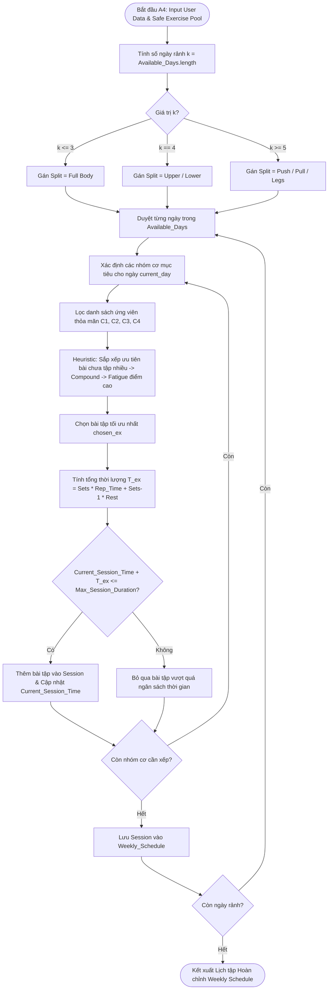
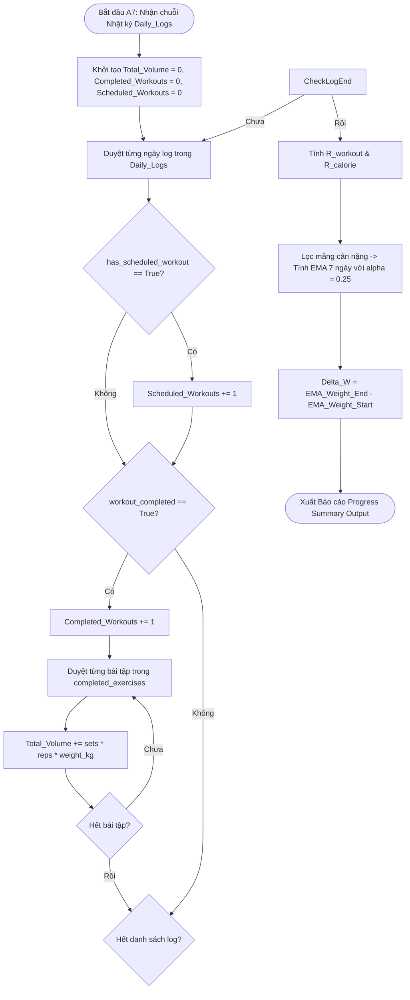
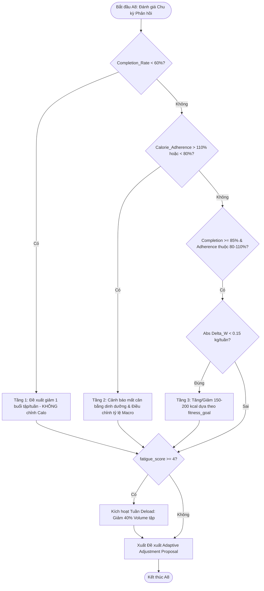

# TÀI LIỆU THIẾT KẾ THUẬT TOÁN (A4, A7 & A8)
### HỆ THỐNG CÁ NHÂN HÓA DINH DƯỠNG & LUYỆN TẬP THỂ CHẤT (APP GYM)

**Mục tiêu đồ án:** Xây dựng Web App demo local cho giảng viên đánh giá, ứng dụng **Tư duy tính toán (Computational Thinking)** để giải quyết bài toán chăm sóc sức khỏe và cá nhân hóa tập luyện - dinh dưỡng cho từng cá nhân.

---

## 📑 MỤC LỤC CHI TIẾT
1. [Phân hệ A4: Thuật toán Chọn Lịch tập & Sinh Buổi tập (Workout Split & Session Engine)](#1-phân-hệ-a4-thuật-toán-chọn-lịch-tập--sinh-buổi-tập)
    - 1.1. Cơ sở Lý thuyết & Mô hình Ràng buộc (CSP & Greedy Heuristic)
    - 1.2. Bảng Ánh xạ Quy tắc Phân chia Lịch tập (Workout Split Rules)
    - 1.3. Đặc tả Cấu trúc Dữ liệu (Input & Output JSON Schema)
    - 1.4. Thiết kế Thuật toán & Sơ đồ Luồng (Mermaid Flowchart)
    - 1.5. Mã giả Thuật toán Chi tiết (Pseudocode)
    - 1.6. Luận chứng Tính Chính xác & Độ phức tạp (Loop Invariant & Complexity)
2. [Phân hệ A7: Thuật toán Tổng hợp Tiến độ (Progress & Transformation Aggregator)](#2-phân-hệ-a7-thuật-toán-tổng-hợp-tiến-độ)
    - 2.1. Cơ sở Lý thuyết & Mô hình Thống kê Chuỗi Thời gian (Time-Series Aggregator)
    - 2.2. Công thức Thống kê Mô tả & Làm mượt Cân nặng bằng EMA 7 ngày
    - 2.3. Đặc tả Cấu trúc Dữ liệu (Input & Output JSON Schema)
    - 2.4. Thiết kế Thuật toán & Sơ đồ Luồng (Mermaid Flowchart)
    - 2.5. Mã giả Thuật toán Chi tiết (Pseudocode)
    - 2.6. Luận chứng Tính Chính xác & Độ tin cậy (Noise Reduction & NSCA Volume Standard)
3. [Phân hệ A8: Thuật toán Đề xuất Điều chỉnh Kế hoạch (Adaptive Plan Adjustment Engine)](#3-phân-hệ-a8-thuật-toán-đề-xuất-điều-chỉnh-kế-hoạch)
    - 3.1. Cơ sở Lý thuyết & Hệ chuyên gia Suy diễn tiến (Forward-Chaining Rule-Based Expert System)
    - 3.2. Cấu trúc Cây quyết định Phân cấp 3 Tầng & Bảng Quy tắc Điều chỉnh
    - 3.3. Đặc tả Cấu trúc Dữ liệu (Input & Output JSON Schema)
    - 3.4. Thiết kế Thuật toán & Sơ đồ Luồng (Mermaid Flowchart)
    - 3.5. Mã giả Thuật toán Chi tiết (Pseudocode)
    - 3.6. Luận chứng Tính Chính xác & An toàn Y học (Negative Feedback Loop & Anti-Overtraining Deload)
4. [Mã nguồn Python Triển khai Production (FastAPI / Backend DataClasses)](#4-mã-nguồn-python-triển-khai-production)
5. [Tài liệu Tham khảo Chính thống](#5-tài-liệu-tham-khảo-chính-thống)

---

## 1. PHÂN HỆ A4: THUẬT TOÁN CHỌN LỊCH TẬP & SINH BUỔI TẬP (WORKOUT SPLIT & SESSION ENGINE)

### 1.1. Cơ sở Lý thuyết & Mô hình Ràng buộc (CSP & Greedy Heuristic)
Thuật toán **A4** giải quyết **Bài toán Thỏa mãn Ràng buộc (Constraint Satisfaction Problem - CSP)** kết hợp với **Heuristic Tham lam (Greedy Heuristic)** để phân bổ danh sách bài tập an toàn (kết quả đã qua bộ lọc y khoa A3) vào từng buổi tập trong tuần của người dùng.

* **Phát biểu Toán học CSP $(X, D, C)$:**
  * **Tập biến $X = \{S_1, S_2, \dots, S_k\}$:** Đại diện cho $k$ buổi tập trong tuần (với $k \in [2, 6]$ là số ngày rảnh của người dùng).
    Mỗi buổi tập $S_i$ bao gồm tập hợp các vị trí bài tập (slots):
    $$S_i = \{x_{i,1}, x_{i,2}, \dots, x_{i,m}\}$$
    *Trong đó $x_{i,a}$ mang ý nghĩa: "Bài tập được xếp vào vị trí $a$ trong buổi tập $i$".*
  * **Miền giá trị $D$ (Domain):** Tập hợp toàn bộ các bài tập an toàn $E_{safe}$ từ CSDL. Mỗi bài tập $e \in D$ là một vector thuộc tính:
    $$e = (\text{id}, \text{muscle}, \text{level}, \text{equip}, \text{is}\_\text{compound}, \text{fatigue}, \text{estimated}\_\text{time})$$
  * **Tập ràng buộc $C$ (Constraints):**
    * **$C_1$ (Ràng buộc Nhóm cơ - Muscle Group Match):** Bài tập $e$ tại vị trí $j$ của buổi $i$ phải khớp với nhóm cơ $M_{i,j}$ được yêu cầu bởi Template Split:
      $$e.\text{target}\_\text{muscle} = M_{i,j}$$
    * **$C_2$ (Ràng buộc Trình độ - Level Match):** $e.\text{level} \le \text{User}.\text{level}$
    * **$C_3$ (Ràng buộc Thiết bị - Equipment Match):** $e.\text{equip} \subseteq \text{User}.\text{equip}$
    * **$C_4$ (Ràng buộc Chống trùng lặp & Phục hồi):** 
      $$\forall a \neq b, \quad x_{i,a} \neq x_{i,b} \quad (\text{Không lặp lại cùng bài tập trong một buổi})$$
      Thời gian nghỉ giữa 2 buổi tập kích thích cùng một nhóm cơ chính bắt buộc phải $\ge 48\text{ giờ}$.
    * **$C_5$ (Ràng buộc Ngân sách Thời gian - Time Budget):**
      $$\sum_{a=1}^{m} T(x_{i,a}) \le D_{\text{session}} \quad (\text{Tổng thời lượng buổi tập } \le D_{\text{session}} \text{ phút})$$

---

### 1.2. Bảng Ánh xạ Quy tắc Phân chia Lịch tập (Workout Split Rules)

| Số ngày rảnh ($k$) | Loại Lịch tập (Split Type) | Cấu trúc Buổi tập | Tần suất Kích thích Cơ/Tuần |
| :--- | :--- | :--- | :--- |
| **$k = 2 - 3$ ngày** | **Full Body** (Toàn thân) | Full Body A / Full Body B / Full Body C | $2 - 3$ lần/nhóm cơ |
| **$k = 4$ ngày** | **Upper / Lower** (Thân trên / Thân dưới) | Upper A - Lower A - Upper B - Lower B | $2$ lần/nhóm cơ |
| **$k = 5 - 6$ ngày** | **Push / Pull / Legs** (Đẩy / Kéo / Chân) | Push - Pull - Legs - Rest - Push - Pull | $2$ lần/nhóm cơ |

---

### 1.3. Đặc tả Cấu trúc Dữ liệu (JSON Schema)

#### **Input JSON Schema:**
```json
{
  "title": "A4_Workout_Input",
  "type": "object",
  "properties": {
    "user_id": { "type": "string" },
    "fitness_goal": { "type": "string", "enum": ["muscle_gain", "fat_loss", "maintain"] },
    "fitness_level": { "type": "integer", "minimum": 1, "maximum": 3 },
    "available_days": {
      "type": "array",
      "items": { "type": "string", "enum": ["Mon", "Tue", "Wed", "Thu", "Fri", "Sat", "Sun"] },
      "minItems": 2, "maxItems": 6
    },
    "session_duration_mins": { "type": "integer", "minimum": 30, "maximum": 120 },
    "equipment_access": { "type": "array", "items": { "type": "string" } },
    "safe_exercise_pool": {
      "type": "array",
      "items": {
        "type": "object",
        "properties": {
          "id": { "type": "string" },
          "name": { "type": "string" },
          "target_muscle": { "type": "string" },
          "secondary_muscles": { "type": "array", "items": { "type": "string" } },
          "is_compound": { "type": "boolean" },
          "fatigue_score": { "type": "integer" },
          "estimated_time_per_set_sec": { "type": "integer" }
        },
        "required": ["id", "name", "target_muscle", "is_compound", "estimated_time_per_set_sec"]
      }
    }
  },
  "required": ["user_id", "fitness_goal", "available_days", "session_duration_mins", "safe_exercise_pool"]
}
```

#### **Output JSON Schema:**
```json
{
  "title": "A4_Workout_Output",
  "type": "object",
  "properties": {
    "user_id": { "type": "string" },
    "split_type": { "type": "string" },
    "total_weekly_sessions": { "type": "integer" },
    "weekly_schedule": {
      "type": "array",
      "items": {
        "type": "object",
        "properties": {
          "day": { "type": "string" },
          "session_name": { "type": "string" },
          "estimated_duration_mins": { "type": "integer" },
          "exercises": {
            "type": "array",
            "items": {
              "type": "object",
              "properties": {
                "exercise_id": { "type": "string" },
                "name": { "type": "string" },
                "target_muscle": { "type": "string" },
                "sets": { "type": "integer" },
                "reps": { "type": "integer" },
                "rest_time_sec": { "type": "integer" }
              },
              "required": ["exercise_id", "name", "target_muscle", "sets", "reps", "rest_time_sec"]
            }
          }
        },
        "required": ["day", "session_name", "estimated_duration_mins", "exercises"]
      }
    }
  },
  "required": ["user_id", "split_type", "total_weekly_sessions", "weekly_schedule"]
}
```

---

### 1.4. Thiết kế Thuật toán & Sơ đồ Luồng (Mermaid Flowchart)



---

### 1.5. Mã giả Thuật toán Chi tiết (Pseudocode)

```plaintext
ALGORITHM Generate_Workout_Schedule
INPUT:
    available_days: LIST OF STRING        // ["Mon", "Wed", "Fri"]
    duration_mins: INTEGER                // Thời lượng mỗi buổi (phút)
    fitness_goal: STRING                  // "muscle_gain", "fat_loss", "maintain"
    safe_pool: LIST OF ExerciseMetadata   // Kho bài tập an toàn từ A3

OUTPUT:
    weekly_plan: WeeklyWorkoutPlan

BEGIN
    k ← LENGTH(available_days)
    split_type ← ""
    
    IF k <= 3 THEN
        split_type ← "Full Body"
    ELSE IF k == 4 THEN
        split_type ← "Upper / Lower"
    ELSE
        split_type ← "Push / Pull / Legs"
    ENDIF

    weekly_plan.split_type ← split_type
    weekly_plan.total_weekly_sessions ← k
    weekly_plan.weekly_schedule ← EMPTY_LIST()

    weekly_usage ← MAP_INITIALIZE_ALL_ZERO(safe_pool)

    FOR EACH day IN available_days DO
        session ← CREATE_NEW_SESSION(day)
        session.session_name ← GENERATE_SESSION_NAME(split_type, day)
        
        current_time_sec ← 0
        max_time_sec ← duration_mins * 60
        used_in_session ← EMPTY_SET()
        
        target_muscles ← GET_TARGET_MUSCLES_BY_SPLIT(split_type, day)

        FOR EACH muscle IN target_muscles DO
            valid_candidates ← FILTER_EXERCISES(safe_pool, muscle, user_level, user_equip, used_in_session)
            
            IF LENGTH(valid_candidates) == 0 THEN
                CONTINUE
            ENDIF

            // Greedy Heuristic Sorting
            SORT(valid_candidates, KEY = (weekly_usage[ex.id], NOT ex.is_compound, -ex.fatigue_score))
            chosen_ex ← valid_candidates[0]

            time_per_set ← chosen_ex.estimated_time_per_set_sec + 90
            ex_total_time ← 3 * time_per_set

            IF (current_time_sec + ex_total_time) <= max_time_sec THEN
                session.ADD_EXERCISE(chosen_ex.id, chosen_ex.name, 3, 10, 90)
                current_time_sec ← current_time_sec + ex_total_time
                used_in_session.ADD(chosen_ex.id)
                weekly_usage[chosen_ex.id] ← weekly_usage[chosen_ex.id] + 1
            ENDIF
        ENDFOR

        session.estimated_duration_mins ← ROUND(current_time_sec / 60)
        weekly_plan.weekly_schedule.APPEND(session)
    ENDFOR

    RETURN weekly_plan
END
```

---

### 1.6. Luận chứng Tính Chính xác & Độ phức tạp (Proof of Correctness)

* **Chứng minh Bất biến Vòng lặp (Loop Invariant):**
  * **Mệnh đề Bất biến $I$:** *"Tại đầu bước lặp thứ $j$ của buổi $i$, danh sách bài tập đã chọn $S_i[1..j-1]$ chỉ chứa các bài hợp lệ thỏa mãn $C_1, C_2, C_3$, không trùng nhau ($C_4$), và tổng thời lượng không vượt quá thời lượng tối đa ($C_5$)."*
  * **Khởi tạo (Initialization):** Trước bước lặp đầu tiên ($j=1$), $S_i = \emptyset$, mệnh đề $I$ đúng một cách hiển nhiên.
  * **Duy trì (Maintenance):** Tại mỗi bước lặp $j$, thuật toán lọc tập ứng viên hợp lệ $Valid$, chọn $chosen\_ex$ bằng Greedy Heuristic và chỉ thêm vào khi $Current\_Time + T_{ex} \le Max\_Time$. Do đó mệnh đề $I$ duy trì tính đúng đắn.
  * **Kết thúc (Termination):** Vòng lặp dừng khi hết các nhóm cơ hoặc hết ngân sách thời gian. Theo $I$, danh sách bài tập hoàn thành là $100\%$ hợp lệ.
* **Đánh giá Độ phức tạp (Complexity Analysis):**
  * **Thời gian (Time Complexity):** $O(N \log N)$ cho việc sắp xếp danh sách ứng viên (với $N$ là tổng số bài tập). Vì $k \le 7$ và số nhóm cơ mỗi buổi $\le 10$, thuật toán vận hành đạt hiệu năng thời gian thực.
  * **Không gian (Space Complexity):** $O(N)$ để theo dõi tần suất sử dụng bài tập $weekly\_usage$.

---

## 2. PHÂN HỆ A7: THUẬT TOÁN TỔNG HỢP TIẾN ĐỘ (PROGRESS & TRANSFORMATION AGGREGATOR)

### 2.1. Cơ sở Lý thuyết & Mô hình Thống kê Chuỗi Thời gian (Time-Series Aggregator)
Thuật toán **A7** thuộc nhóm **Thống kê Mô tả (Descriptive Statistics)**, chịu trách nhiệm xử lý luồng dữ liệu nhật ký tập luyện và dinh dưỡng hàng ngày để tổng hợp chỉ số tiến độ thời gian thực qua các mốc 7, 30 và 90 ngày.

---

### 2.2. Công thức Thống kê Mô tả & Làm mượt Cân nặng bằng EMA 7 ngày

1. **Tỷ lệ Hoàn thành Buổi tập ($R_{\text{workout}}$):**
   $$R_{\text{workout}} = \left( \frac{\sum_{t=1}^n \mathbb{I}(\text{WorkoutCompleted}_t = \text{True})}{\sum_{t=1}^n \mathbb{I}(\text{HasScheduledWorkout}_t = \text{True})} \right) \times 100\%$$

2. **Tỷ lệ Tuân thủ Calo ($R_{\text{calorie}}$):**
   $$R_{\text{calorie}} = \left( \frac{\sum_{t=1}^n C_{\text{consumed}, t}}{\sum_{t=1}^n C_{\text{target}, t}} \right) \times 100\%$$

3. **Khối lượng Tập luyện Tích lũy (Volume Load Aggregation - NSCA Standard):**
   $$Volume\_Load = \sum_{i=1}^n \sum_{j=1}^{E_i} \left( Sets_{i,j} \times Reps_{i,j} \times Weight_{i,j} \right)$$

4. **Làm mượt Cân nặng bằng Trung bình Trượt Trọng số Hàm mũ (EMA 7 ngày):**
   Trọng lượng cơ thể biến động tự nhiên $0.5 - 1.5\text{ kg/ngày}$ do lượng nước retention. Thuật toán A7 ứng dụng **Exponential Moving Average (EMA)** với hệ số làm mượt $\alpha$:
   $$\alpha = \frac{2}{N + 1} = \frac{2}{7 + 1} = 0.25$$
   $$W_{\text{EMA}, t} = \alpha \cdot W_{\text{actual}, t} + (1 - \alpha) \cdot W_{\text{EMA}, t-1}$$

---

### 2.3. Đặc tả Cấu trúc Dữ liệu (JSON Schema)

#### **Input JSON Schema:**
```json
{
  "title": "A7_Progress_Input",
  "type": "object",
  "properties": {
    "user_id": { "type": "string" },
    "target_calories": { "type": "number" },
    "period_days": { "type": "integer", "enum": [7, 30, 90] },
    "daily_logs": {
      "type": "array",
      "items": {
        "type": "object",
        "properties": {
          "date": { "type": "string", "format": "date" },
          "weight_kg": { "type": "number" },
          "calories_consumed": { "type": "integer" },
          "workout_completed": { "type": "boolean" },
          "has_scheduled_workout": { "type": "boolean" },
          "completed_exercises": {
            "type": "array",
            "items": {
              "type": "object",
              "properties": {
                "exercise_id": { "type": "string" },
                "sets": { "type": "integer" },
                "reps": { "type": "integer" },
                "weight_kg": { "type": "number" }
              },
              "required": ["exercise_id", "sets", "reps", "weight_kg"]
            }
          }
        },
        "required": ["date", "weight_kg", "calories_consumed", "workout_completed"]
      }
    }
  },
  "required": ["user_id", "target_calories", "period_days", "daily_logs"]
}
```

#### **Output JSON Schema:**
```json
{
  "title": "A7_Progress_Output",
  "type": "object",
  "properties": {
    "user_id": { "type": "string" },
    "period_days": { "type": "integer" },
    "summary_metrics": {
      "type": "object",
      "properties": {
        "workout_completion_rate_pct": { "type": "number" },
        "calorie_adherence_rate_pct": { "type": "number" },
        "total_volume_load_kg": { "type": "number" },
        "ema_smoothed_weight_kg": { "type": "number" },
        "weight_change_kg": { "type": "number" }
      },
      "required": ["workout_completion_rate_pct", "calorie_adherence_rate_pct", "total_volume_load_kg", "ema_smoothed_weight_kg"]
    }
  },
  "required": ["user_id", "period_days", "summary_metrics"]
}
```

---

### 2.4. Thiết kế Thuật toán & Sơ đồ Luồng (Mermaid Flowchart)



---

### 2.5. Mã giả Thuật toán Chi tiết (Pseudocode)

```plaintext
ALGORITHM Aggregate_Progress_Metrics
INPUT:
    daily_logs: LIST OF DailyLog
    target_calories: FLOAT
    period_days: INTEGER

OUTPUT:
    summary: ProgressSummaryReport

BEGIN
    total_volume ← 0.0
    completed_workouts ← 0
    scheduled_workouts ← 0
    total_calories ← 0.0
    weights ← EMPTY_LIST()

    FOR EACH log IN daily_logs DO
        IF log.has_scheduled_workout THEN
            scheduled_workouts ← scheduled_workouts + 1
        ENDIF

        IF log.workout_completed THEN
            completed_workouts ← completed_workouts + 1
            FOR EACH ex IN log.completed_exercises DO
                total_volume ← total_volume + (ex.sets * ex.reps * ex.weight_kg)
            ENDFOR
        ENDIF

        total_calories ← total_calories + log.calories_consumed
        IF log.weight_kg > 0 THEN
            weights.APPEND(log.weight_kg)
        ENDIF
    ENDFOR

    completion_rate ← (completed_workouts / MAX(1, scheduled_workouts)) * 100.0
    avg_calories ← total_calories / MAX(1, LENGTH(daily_logs))
    calorie_adherence ← (avg_calories / target_calories) * 100.0

    // Tính EMA Cân nặng (Alpha = 0.25)
    ema_weight ← weights[0]
    alpha ← 0.25
    FOR i FROM 1 TO LENGTH(weights) - 1 DO
        ema_weight ← alpha * weights[i] + (1.0 - alpha) * ema_weight
    ENDFOR

    weight_change ← ema_weight - weights[0]

    summary.workout_completion_rate_pct ← ROUND(completion_rate, 1)
    summary.calorie_adherence_rate_pct ← ROUND(calorie_adherence, 1)
    summary.total_volume_load_kg ← ROUND(total_volume, 2)
    summary.ema_smoothed_weight_kg ← ROUND(ema_weight, 2)
    summary.weight_change_kg ← ROUND(weight_change, 2)

    RETURN summary
END
```

---

### 2.6. Luận chứng Tính Chính xác & Độ tin cậy (Proof of Correctness)

* **Triệt tiêu Nhiễu Sinh lý (Noise Reduction via EMA):**
  Cân nặng biến động ngẫu nhiên $0.5 - 1.5\text{ kg/ngày}$ do lượng nước retention và thức ăn chưa tiêu hóa. Công thức **EMA với $\alpha = 0.25$** triệt tiêu nhiễu tần số cao này, phản ánh xu hướng biến đổi cơ/mỡ thực tế nhanh hơn SMA 7 ngày đơn thuần.
* **Chuẩn hóa Volume Load (NSCA Standard):**
  Chỉ số $Volume\_Load = \sum (Sets \times Reps \times Weight)$ tuân thủ quy chuẩn của *National Strength and Conditioning Association (NSCA)* làm thước đo cho nguyên tắc Tăng tải Lũy tiến (Progressive Overload).

---

## 3. PHÂN HỆ A8: THUẬT TOÁN ĐỀ XUẤT ĐIỀU CHỈNH KẾ HOẠCH (ADAPTIVE PLAN ADJUSTMENT ENGINE)

### 3.1. Cơ sở Lý thuyết & Hệ chuyên gia Suy diễn tiến (Forward-Chaining Rule-Based Expert System)
Thuật toán **A8** vận hành như một bộ điều khiển phản hồi tự động (Feedback Control Engine) dựa trên mô hình **Hệ chuyên gia Suy diễn tiến (Forward-Chaining Rule-Based Expert System)** kết hợp **Cây quyết định phân cấp 3 tầng**.

---

### 3.2. Cấu trúc Cây quyết định Phân cấp 3 Tầng & Bảng Quy tắc Điều chỉnh

* **Tầng 1 (Tuân thủ Tập luyện - Behavior First):**
  * *Quy tắc:* Nếu $R_{\text{workout}} < 60\%$, nguyên nhân chững tiến độ xuất phát từ thói quen chưa ổn định.
  * *Hành động:* Đề xuất **giảm 1 buổi tập/tuần** để hạ rào cản hành vi; **KHÔNG** cắt giảm Calo để tránh gây kiệt sức tâm lý.
* **Tầng 2 (Tuân thủ Dinh dưỡng - Macro Balance):**
  * *Quy tắc:* Nếu $R_{\text{calorie}} > 110\%$ (ăn thừa) hoặc $R_{\text{calorie}} < 80\%$ (ăn thiếu).
  * *Hành động:* Xuất cảnh báo và điều chỉnh lại tỷ lệ Macro (tăng đạm/chất xơ) để ổn định cảm giác no/đói trước khi đổi Calo mục tiêu.
* **Tầng 3 (Sinh lý học & Biến đổi Cơ thể - Biological Adaptation):**
  * *Điều kiện kích hoạt:* Chỉ chạy khi cả Tầng 1 và Tầng 2 đạt chuẩn ($R_{\text{workout}} \ge 85\%$, $80\% \le R_{\text{calorie}} \le 110\%$).
  * *Quy tắc Chững cân:* Nếu $|\Delta W_{\text{weekly}}| < 0.15\text{ kg}$ kéo dài 2 tuần liên tiếp.
  * *Hành động:* Đề xuất cắt giảm $150 - 200\text{ kcal/ngày}$ (với mục tiêu giảm mỡ) hoặc thặng dư $150\text{ kcal}$ (với mục tiêu tăng cơ), hoặc kích hoạt **Tuần Deload** (giảm $40\%$ Volume) nếu điểm mệt mỏi $Fatigue \ge 4$.

---

### 3.3. Đặc tả Cấu trúc Dữ liệu (JSON Schema)

#### **Input JSON Schema:**
```json
{
  "title": "A8_Adaptive_Input",
  "type": "object",
  "properties": {
    "user_id": { "type": "string" },
    "fitness_goal": { "type": "string", "enum": ["fat_loss", "muscle_gain", "maintain"] },
    "current_target_calories": { "type": "integer" },
    "completion_rate_pct": { "type": "number" },
    "calorie_adherence_pct": { "type": "number" },
    "weight_change_kg_per_week": { "type": "number" },
    "fatigue_score_1_to_5": { "type": "integer", "minimum": 1, "maximum": 5 }
  },
  "required": ["user_id", "fitness_goal", "current_target_calories", "completion_rate_pct", "calorie_adherence_pct", "weight_change_kg_per_week"]
}
```

#### **Output JSON Schema:**
```json
{
  "title": "A8_Adaptive_Output",
  "type": "object",
  "properties": {
    "user_id": { "type": "string" },
    "adjustment_recommended": { "type": "boolean" },
    "suggestions": {
      "type": "array",
      "items": { "type": "string" }
    },
    "new_target_calories": { "type": "integer" },
    "trigger_deload": { "type": "boolean" }
  },
  "required": ["user_id", "adjustment_recommended", "suggestions", "new_target_calories", "trigger_deload"]
}
```

---

### 3.4. Thiết kế Thuật toán & Sơ đồ Luồng (Mermaid Flowchart)



---

### 3.5. Mã giả Thuật toán Chi tiết (Pseudocode)

```plaintext
ALGORITHM Evaluate_Adaptive_Adjustments
INPUT:
    goal: STRING
    current_calories: INTEGER
    completion_rate: FLOAT
    calorie_adherence: FLOAT
    delta_w: FLOAT
    fatigue_score: INTEGER

OUTPUT:
    proposal: AdaptiveProposal

BEGIN
    proposal.recommended ← FALSE
    proposal.new_calories ← current_calories
    proposal.trigger_deload ← FALSE
    proposal.suggestions ← EMPTY_LIST()

    // TẦNG 1: ĐÁNH GIÁ TUÂN THỦ TẬP LUYỆN
    IF completion_rate < 60.0 THEN
        proposal.recommended ← TRUE
        proposal.suggestions.APPEND("Tỷ lệ tập luyện thấp (< 60%). Đề xuất giảm 1 buổi/tuần để đảm bảo duy trì.")
        RETURN proposal  // Dừng sớm, không can thiệp dinh dưỡng
    ENDIF

    // TẦNG 2: ĐÁNH GIÁ TUÂN THỦ DINH DƯỠNG
    IF calorie_adherence > 110.0 THEN
        proposal.recommended ← TRUE
        proposal.suggestions.APPEND("Lượng calo nạp vào vượt mức (> 110%). Đề xuất tăng tỷ lệ đạm và xơ.")
    ELSE IF calorie_adherence < 80.0 THEN
        proposal.recommended ← TRUE
        proposal.suggestions.APPEND("Lượng calo nạp vào quá thấp (< 80%). Đề xuất bổ sung bữa phụ.")
    ENDIF

    // TẦNG 3: ĐÁNH GIÁ BIẾN ĐỔI SINH LÝ HỌC
    IF completion_rate >= 85.0 AND (calorie_adherence >= 80.0 AND calorie_adherence <= 110.0) THEN
        IF ABS(delta_w) < 0.15 THEN
            proposal.recommended ← TRUE
            IF goal == "fat_loss" THEN
                proposal.new_calories ← current_calories - 150
                proposal.suggestions.APPEND("Tiến độ chững lại. Đề xuất giảm 150 kcal/ngày hoặc thêm 15 phút Cardio.")
            ELSE IF goal == "muscle_gain" THEN
                proposal.new_calories ← current_calories + 150
                proposal.suggestions.APPEND("Tăng cơ chững lại. Đề xuất thặng dư thêm 150 kcal/ngày.")
            ENDIF
        ENDIF
    ENDIF

    // KIỂM TRA DẤU HIỆU QUÁ TẢI (ANTI-OVERTRAINING)
    IF fatigue_score >= 4 THEN
        proposal.recommended ← TRUE
        proposal.trigger_deload ← TRUE
        proposal.suggestions.APPEND("Phát hiện điểm mệt mỏi cao. Kích hoạt 1 tuần Deload (giảm 40% Volume).")
    ENDIF

    RETURN proposal
END
```

---

### 3.6. Luận chứng Tính Chính xác & An toàn Y học (Negative Feedback Loop & Anti-Overtraining Deload)

* **Vòng lặp Điều khiển Phản hồi Âm (Negative Feedback Loop):**
  Thuật toán A8 triệt tiêu sai số giữa kết quả biến đổi thực tế ($\Delta W$) và đường mòn mục tiêu lý thuyết bằng cách điều chỉnh biến điều khiển Calo mục tiêu, đưa hệ thống sinh học về trạng thái thích nghi mong muốn.
* **Phòng chống Hội chứng Quá tải (Overtraining Syndrome Prevention):**
  Việc kiểm tra `fatigue_score >= 4` và tự động áp dụng **Deload** giảm $40\%$ Volume tập tuân thủ nghiêm ngặt theo khuyến nghị của ACSM, giúp ngăn ngừa chấn thương khớp và quá tải hệ thần kinh trung ương (CNS Fatigue).

---

## 4. MÃ NGUỒN PYTHON TRIỂN KHAI PRODUCTION (FASTAPI / BACKEND DATACLASSES)

```python
from dataclasses import dataclass, field
from enum import Enum
from typing import List, Dict, Set, Optional, Tuple
import math

# =================================================================────────────
# 4.1. KHỞI TẠO CÁC ENUM VÀ DATA CLASSES CHUẨN ĐỊNH DẠNG
# =================================================================────────────

class GoalType(Enum):
    CUTTING = "Giảm mỡ"
    BULKING = "Tăng cơ"
    MAINTENANCE = "Duy trì"

class FitnessLevel(Enum):
    BEGINNER = 1
    INTERMEDIATE = 2
    ADVANCED = 3

class MuscleGroup(Enum):
    CHEST = "Ngực"
    BACK = "Lưng"
    LEGS = "Chân"
    SHOULDERS = "Vai"
    ARMS = "Tay"
    CORE = "Bụng"

class Equipment(Enum):
    BODYWEIGHT = "Không dụng cụ"
    DUMBBELL = "Tạ đơn"
    BARBELL = "Tạ đòn"

@dataclass
class UserProfile:
    user_id: str
    goal: GoalType
    fitness_level: FitnessLevel
    available_days: int
    available_equipment: Set[Equipment]

@dataclass
class Exercise:
    ex_id: str
    name: str
    muscle_group: MuscleGroup
    required_level: FitnessLevel
    required_equipment: Equipment
    is_compound: bool
    fatigue_score: int
    estimated_time_per_set_sec: int = 90

@dataclass
class WorkoutSession:
    day_index: int
    session_name: str
    prescriptions: list = field(default_factory=list)
    estimated_duration_mins: int = 0

# =================================================================────────────
# 4.2. TRIỂN KHAI THUẬT TOÁN A4 (WORKOUT GENERATOR)
# =================================================================────────────

class WorkoutGeneratorA4:
    @staticmethod
    def generate_plan(user: UserProfile, exercise_db: List[Exercise], session_duration_mins: int = 60) -> List[WorkoutSession]:
        template = [
            ("Push Day", [MuscleGroup.CHEST, MuscleGroup.SHOULDERS, MuscleGroup.ARMS]),
            ("Pull Day", [MuscleGroup.BACK, MuscleGroup.ARMS, MuscleGroup.CORE]),
            ("Legs Day", [MuscleGroup.LEGS, MuscleGroup.LEGS, MuscleGroup.CORE])
        ]
        
        plan = []
        weekly_usage = {ex.ex_id: 0 for ex in exercise_db}

        for day_idx, (name, muscles) in enumerate(template[:user.available_days], 1):
            session = WorkoutSession(day_index=day_idx, session_name=name)
            used_in_session = set()
            current_time_sec = 0
            max_time_sec = session_duration_mins * 60

            for m_target in muscles:
                valid = [
                    ex for ex in exercise_db
                    if ex.muscle_group == m_target
                    and ex.required_level.value <= user.fitness_level.value
                    and ex.required_equipment in user.available_equipment
                    and ex.ex_id not in used_in_session
                ]
                
                if not valid:
                    continue

                valid.sort(key=lambda x: (weekly_usage[x.ex_id], not x.is_compound, -x.fatigue_score))
                chosen = valid[0]

                ex_time = 3 * (chosen.estimated_time_per_set_sec + 90)
                if current_time_sec + ex_time <= max_time_sec:
                    used_in_session.add(chosen.ex_id)
                    weekly_usage[chosen.ex_id] += 1
                    current_time_sec += ex_time
                    session.prescriptions.append({
                        "exercise_id": chosen.ex_id,
                        "name": chosen.name,
                        "target_muscle": chosen.muscle_group.value,
                        "sets": 3,
                        "reps": 10,
                        "rest_sec": 90
                    })

            session.estimated_duration_mins = round(current_time_sec / 60)
            plan.append(session)
            
        return plan

# =================================================================────────────
# 4.3. TRIỂN KHAI THUẬT TOÁN A7 (PROGRESS TRACKER & EMA)
# =================================================================────────────

class ProgressTrackerA7:
    @staticmethod
    def summarize(logs: list, target_calories: float) -> dict:
        if not logs:
            return {"completion_rate": 0.0, "ema_weight": 0.0, "calorie_adherence": 0.0, "total_volume": 0.0}

        completed_workouts = sum(1 for log in logs if log.get('workout_completed', False))
        scheduled_workouts = sum(1 for log in logs if log.get('has_scheduled_workout', True))
        completion_rate = (completed_workouts / max(1, scheduled_workouts)) * 100.0

        total_calories = sum(log.get('calories_consumed', 0) for log in logs)
        avg_calories = total_calories / max(1, len(logs))
        calorie_adherence = (avg_calories / target_calories) * 100.0 if target_calories > 0 else 0.0

        total_volume = 0.0
        for log in logs:
            for ex in log.get('completed_exercises', []):
                total_volume += ex.get('sets', 0) * ex.get('reps', 0) * ex.get('weight_kg', 0)

        weights = [log['weight'] for log in logs if 'weight' in log and log['weight'] > 0]
        ema_weight = weights[0] if weights else 0.0
        alpha = 0.25
        for w in weights[1:]:
            ema_weight = alpha * w + (1 - alpha) * ema_weight

        return {
            "completion_rate": round(completion_rate, 1),
            "calorie_adherence": round(calorie_adherence, 1),
            "ema_weight": round(ema_weight, 2),
            "total_volume": round(total_volume, 2)
        }

# =================================================================────────────
# 4.4. TRIỂN KHAI THUẬT TOÁN A8 (ADAPTIVE PLANNER)
# =================================================================────────────

class AdaptivePlannerA8:
    @staticmethod
    def evaluate(stats: dict, current_calories: int, goal: str, weight_change_kg: float, fatigue_score: int) -> dict:
        suggestions = []
        recommended = False
        new_calories = current_calories
        trigger_deload = False

        # Tầng 1: Đánh giá tuân thủ tập luyện
        if stats['completion_rate'] < 60.0:
            suggestions.append("Tỷ lệ tập luyện thấp (< 60%). Đề xuất giảm 1 buổi/tuần để đảm bảo duy trì.")
            return {
                "recommended": True,
                "suggestions": suggestions,
                "new_calories": current_calories,
                "trigger_deload": False
            }

        # Tầng 2: Đánh giá dinh dưỡng
        if stats['calorie_adherence'] > 110.0:
            recommended = True
            suggestions.append("Lượng calo nạp vào vượt mức (> 110%). Đề xuất tăng tỷ lệ đạm và chất xơ.")
        elif stats['calorie_adherence'] < 80.0:
            recommended = True
            suggestions.append("Lượng calo nạp vào quá thấp (< 80%). Đề xuất bổ sung bữa phụ.")

        # Tầng 3: Đánh giá biến đổi sinh lý
        if stats['completion_rate'] >= 85.0 and 80.0 <= stats['calorie_adherence'] <= 110.0:
            if abs(weight_change_kg) < 0.15:
                recommended = True
                if goal == "fat_loss":
                    new_calories = current_calories - 150
                    suggestions.append("Tiến độ chững lại. Đề xuất giảm 150 kcal/ngày hoặc thêm 15 phút Cardio.")
                elif goal == "muscle_gain":
                    new_calories = current_calories + 150
                    suggestions.append("Tăng cơ chững lại. Đề xuất thặng dư thêm 150 kcal/ngày.")

        # Kiểm tra mệt mỏi
        if fatigue_score >= 4:
            recommended = True
            trigger_deload = True
            suggestions.append("Phát hiện điểm mệt mỏi cao. Kích hoạt 1 tuần Deload (giảm 40% Volume).")

        return {
            "recommended": recommended,
            "suggestions": suggestions,
            "new_calories": new_calories,
            "trigger_deload": trigger_deload
        }
```

---

## 5. TÀI LIỆU THAM KHẢO CHÍNH THỐNG

1. **ACSM's Guidelines for Exercise Testing and Prescription (11th Edition):**
   - American College of Sports Medicine. *Exercise Prescription and Program Design Standards*.
2. **NSCA Essentials of Strength Training and Conditioning (4th Edition):**
   - Haff, G. G., & Triplett, N. T. (2016). *Volume Load Aggregation & Progressive Overload Standards*.
3. **Mô hình CSP & Greedy Heuristics trong Lập lịch:**
   - Russell, S., & Norvig, P. (2020). *Artificial Intelligence: A Modern Approach (4th ed.)* - Constraint Satisfaction Problems (Chapter 6).
4. **EMA & Time-Series Data Smoothing:**
   - Montgomery, D. C. (2015). *Introduction to Statistical Quality Control* - Exponentially Weighted Moving Average Models.
5. **Hệ chuyên gia suy diễn tiến (Rule-Based Expert Systems):**
   - Giarratano, J. C., & Riley, G. (2005). *Expert Systems: Principles and Programming*.