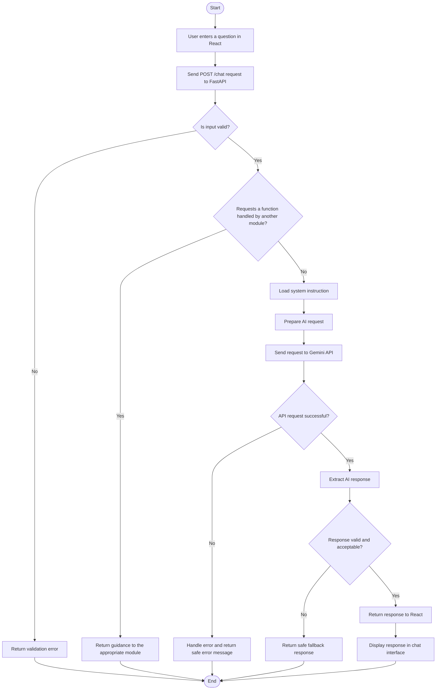
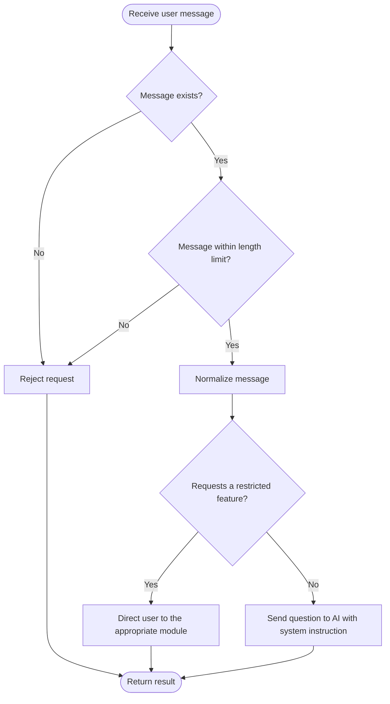
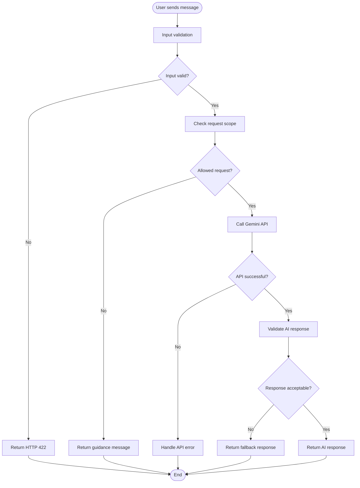

# AI Chatbot

## Với module này tạm thời ta sẽ lấy Gemini API từ Google AI Studio (free)
## Tổng quát thì để tạo ràng buộc, mình sẽ có 2 phần là đưa một file hướng dẫn cho AI để nó đọc và trả lời đúng + input validation ngay từ đầu.

## Cách lấy Gemini API:
- Truy cập trang web Google AI Studio: [https://aistudio.google.com/api-keys](https://aistudio.google.com/api-keys)
- Ấn Create API key để lấy API key cho project.
- Chọn model:
```python
import os
from google import genai

# Cấu hình API key (khuyến nghị lưu vào biến môi trường)
# Hoặc bạn có thể gán trực tiếp: client = genai.Client(api_key="API_KEY_CỦA_BẠN")
client = genai.Client()

response = client.models.generate_content(
    model='gemini-3.8-flash',  # Chọn model Flash 3.8 tại đây
    contents='Xin chào, hãy giới thiệu ngắn gọn về bạn.',
)

print(response.text)
```
- Model free mạnh nhất mình có thể xài là 3.8 flash.


# 1. Pseudocode cho module Chatbot

Chia pseudocode thành 3 phần để dễ hiểu và dễ chuyển sang code Python sau này:

1. Xử lý request tại backend.
2. Kiểm tra câu hỏi và gọi AI.
3. Kiểm tra kết quả và trả response.

## 1.1. Pseudocode tổng quát

```text
ALGORITHM HandleChatRequest

INPUT:
    request containing user's message

OUTPUT:
    chatbot response or error message

BEGIN
    1. Receive request from React.

    2. Validate input:
        IF message is missing
           OR message is empty
           OR message exceeds maximum length THEN
            RETURN validation error
        END IF

    3. Normalize the message.

    4. Check whether the request asks for a function
       handled by another module.

       IF request asks to generate a workout schedule
          OR generate a meal plan
          OR modify a plan
          OR update user progress THEN
            RETURN message directing the user
                   to the appropriate module
       END IF

    5. Load the chatbot's system instruction.

    6. Send the message and system instruction to Gemini API.

    7. Wait for AI response.

    8. Handle AI errors:
        IF the API request fails THEN
            RETURN a safe error message
        END IF

    9. Validate AI response:
        IF response is empty
           OR response violates application rules THEN
            RETURN a safe fallback response
        END IF

    10. Return the response to React.

END
```

**Lưu ý:** Bước 4 là kiểm tra chức năng, không phải kết luận mọi câu hỏi ngoài chủ đề đều bị từ chối. Bước 9 cũng cần cơ chế kiểm tra phù hợp; không thể xác định một câu trả lời an toàn hay chính xác chỉ bằng cách kiểm tra nó có rỗng hay không.

## 1.2. Pseudocode kiểm tra câu hỏi và gọi AI

Để dễ tổ chức code, ta có thể tách phần xử lý chatbot thành một service riêng.

```text
ALGORITHM GenerateChatbotResponse

INPUT:
    message
    system_instruction

OUTPUT:
    AI response

BEGIN
    1. Check whether the message requests a restricted
       application function.

       IF it does THEN
           RETURN a message directing the user
                  to the appropriate module
       END IF

    2. Construct the AI request using:
           - system_instruction
           - user message
           - conversation history, if supported

    3. Send the request to Gemini API.

    4. IF the API returns an error THEN
           Log the error safely.
           RETURN an error result
       END IF

    5. Extract the AI response.

    6. IF the response is empty THEN
           RETURN an error result
       END IF

    7. Apply any required output validation.

    8. RETURN the response.

END
```

Ở bước 2, `system_instruction` chứa các quy tắc về phạm vi kiến thức, phong cách trả lời và an toàn. Nếu chatbot hỗ trợ hội thoại nhiều lượt, backend cũng cần gửi lịch sử hội thoại thích hợp để AI hiểu ngữ cảnh.

---

# 2. Flowchart cho module Chatbot

## 2.1. Flowchart tổng quan

Đây là flowchart thể hiện toàn bộ luồng xử lý từ lúc người dùng đặt câu hỏi đến khi nhận được câu trả lời.



### Cách đọc flowchart

**Bước 1 — Người dùng nhập câu hỏi**

Ví dụ:

> TDEE là gì và nó có tác dụng gì?

React gửi câu hỏi đến endpoint `POST /chat` của FastAPI.

**Bước 2 — Kiểm tra dữ liệu đầu vào**

Backend kiểm tra:
- Có trường `message` hay không.
- Nội dung có phải chuỗi hợp lệ hay không.
- Nội dung có rỗng hoặc vượt quá giới hạn độ dài hay không.

Nếu dữ liệu không hợp lệ, backend trả lỗi mà không cần gọi Gemini.

**Bước 3 — Kiểm tra chức năng**

Backend kiểm tra xem yêu cầu có thuộc chức năng mà chatbot không được thực hiện hay không.

Ví dụ:
- "Progressive overload là gì?" → Tiếp tục xử lý.
- "Tạo cho tôi lịch tập 6 ngày" → Hướng dẫn người dùng sang module tạo lịch tập.

**Bước 4 — Gọi Gemini API**

Backend gửi câu hỏi cùng system instruction và, nếu cần, lịch sử hội thoại đến Gemini.

**Bước 5 — Kiểm tra kết quả**

Nếu API gặp lỗi, backend trả thông báo lỗi phù hợp.

Nếu có câu trả lời, backend kiểm tra kết quả theo các quy tắc đã thiết kế trước khi gửi về React. Với yêu cầu an toàn nội dung nghiêm ngặt hơn, cần bổ sung cơ chế kiểm tra riêng; system instruction tự nó không đảm bảo tuyệt đối rằng mọi câu trả lời đều an toàn.

**Bước 6 — Hiển thị kết quả**

React nhận response và hiển thị nội dung trong giao diện chat.

---

## 2.2. Flowchart riêng cho việc xử lý câu hỏi

Nếu mày cần trình bày chi tiết hơn trong báo cáo, có thể tách phần kiểm tra câu hỏi thành flowchart riêng.



Flowchart này tập trung vào **input validation và business rules**, không mô tả phần gọi API hay kiểm tra câu trả lời.

---

# 3. Bảng mô tả các bước xử lý

Bảng dưới đây có thể dùng trong tài liệu thiết kế hệ thống hoặc báo cáo dự án.

| Step | Process | Description | Expected result |
|---|---|---|---|
| 1 | Receive input | Receive the user's question from React | Request received |
| 2 | Input validation | Check required fields, data type and message length | Valid input or validation error |
| 3 | Feature restriction check | Detect requests for functions handled by other modules | Continue or redirect user |
| 4 | Prepare AI request | Combine system instruction, message and optional conversation history | AI request prepared |
| 5 | Call Gemini API | Send the request to the AI model | AI response or API error |
| 6 | Error handling | Handle API failures and unexpected results | Safe error response |
| 7 | Output validation | Check the response against applicable output requirements | Accepted response or fallback |
| 8 | Return response | Send the result to React | Response displayed in chat |

---

# 4. Một số quyết định thiết kế quan trọng

Để module này vừa đơn giản vừa có thể mở rộng, tao đề xuất:

### A. Không cần database riêng chỉ để lưu system instruction

Mày có thể lưu system instruction trong file `fitness_chatbot.md` và đọc nó khi backend khởi động.

Nếu sau này muốn lưu lịch sử hội thoại, đánh giá câu trả lời hoặc quản lý các cuộc trò chuyện giữa nhiều người dùng, lúc đó mới cân nhắc thiết kế database cho chatbot.

### B. Không nên chỉ dùng từ khóa để kiểm soát toàn bộ câu hỏi

Kiểm tra từ khóa hữu ích đối với một số chức năng rõ ràng, nhưng không hiểu đầy đủ ý nghĩa của câu hỏi.

Ví dụ, hai câu sau khác nhau:

- "Tạo cho tôi lịch tập gym."
- "Tại sao người mới nên có lịch tập gym?"

Câu đầu yêu cầu thực hiện chức năng tạo lịch; câu thứ hai hỏi kiến thức. Hệ thống cần phân biệt được hai trường hợp này thay vì từ chối mọi câu có từ "lịch tập".

### C. Phân biệt lỗi hệ thống và câu hỏi ngoài phạm vi

- **Lỗi hệ thống:** Gemini API không phản hồi hoặc gặp lỗi.
- **Câu hỏi ngoài phạm vi:** Người dùng hỏi về chủ đề chatbot không hỗ trợ.
- **Yêu cầu chức năng khác:** Người dùng muốn tạo lịch tập hoặc thực đơn, vốn thuộc module khác.

Ba trường hợp này nên có cách xử lý riêng để giao diện React có thể thông báo phù hợp.

---

## 5. Validation như thế nào


## 6. Kiến trúc cuối cùng được đề xuất

```text
React Chat Interface
         |
         v
FastAPI Chat Endpoint
         |
         v
Input Validation (Pydantic)
         |
         v
Business Rules / Feature Restrictions
         |
         v
Chatbot Service
         |
         +------ System Instruction
         |
         +------ Conversation History (optional)
         |
         v
Gemini API
         |
         v
Output Validation & Error Handling
         |
         v
FastAPI Response
         |
         v
React Chat Interface
```

**Tóm lại:** Với phiên bản demo, nhóm mày có thể triển khai chatbot theo luồng này mà chưa cần RAG, fine-tuning hay một mô hình AI chạy local. Những phần quan trọng nhất là input validation, giới hạn chức năng, system instruction và xử lý lỗi. Sau khi luồng cơ bản hoạt động ổn định, nhóm có thể bổ sung lịch sử hội thoại và cơ chế kiểm tra nội dung nâng cao.